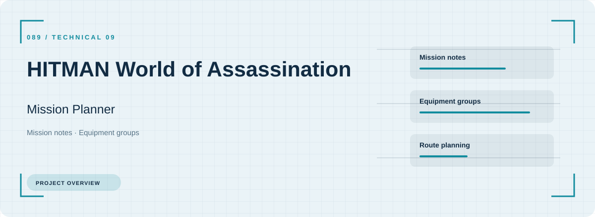
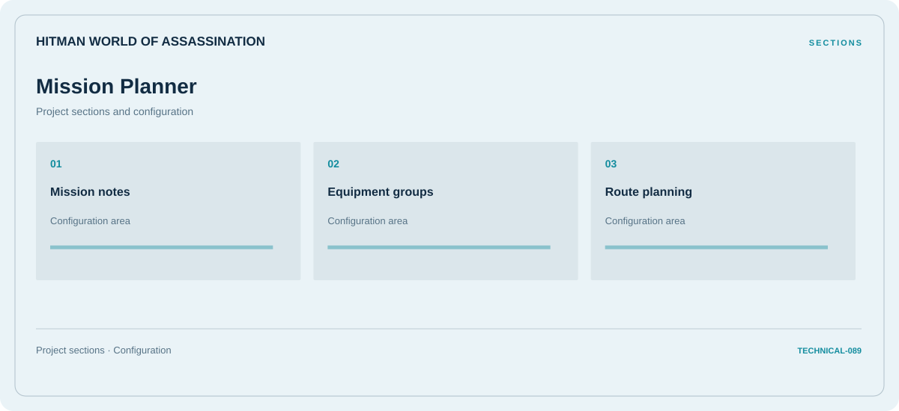

# 🎮 HITMAN World of Assassination Mission Planner

**Mission notes · Equipment groups · Route planning**

## ⚡ Features

Mission notes, equipment groups, and route planning form the core of HITMAN World of Assassination Mission Planner. Related configuration is grouped by task rather than collected in an undifferentiated list.

### ⚙️ Mission notes

Session and activity information grouped by the task or context it belongs to.

### 🧩 Equipment groups

Equipment categories and the associated selection or configuration options.

### ⌨️ Route planning

Route stages, transport context, and the notes associated with each part of the journey.

## 🖥️ Project navigation

## 📥 Download

The button and cover open the project's download page. Use the information supplied with the downloaded package for installation and release-specific requirements.

## 📚 Project documentation

- [Feature reference](docs/FEATURES.md)
- [Download information](docs/DOWNLOAD.md)
- [Project page](index.html)

---

HITMAN World of Assassination Mission Planner · Program documentation and download information.
                                                                                                    